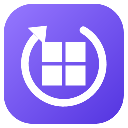
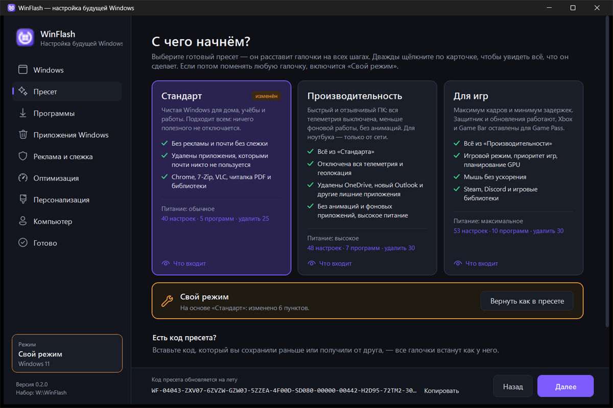

<p align="center">
  
</p>

<h1 align="center">WinFlash</h1>

<p align="center">
  A USB stick for reinstalling Windows 10 and 11 that leaves nothing to set up afterwards:<br>
  your apps install themselves, ads and tracking are off, bloatware is gone.
</p>

<p align="center">
  <a href="https://github.com/nortex-labs/WinFlash/releases/latest"></a>
  <a href="LICENSE"></a>
  
</p>

<p align="center"><a href="README.md">Русский</a> · <b>English</b></p>

> [!NOTE]
> The app interface is in Russian only for now.



## Download

Get these files from the [latest release](https://github.com/nortex-labs/WinFlash/releases/latest):

| File | What it is |
|---|---|
| `WinFlash-<version>.zip` | The configurator. Unzip it to the root of the USB stick. |
| `WinFlash-Setup.iso` | Boot image for setting everything up right from the USB boot menu. Put it in the `ISO` folder. |

You also need [Ventoy](https://www.ventoy.net) (makes the stick bootable) and a Windows ISO from Microsoft:
[Windows 11](https://www.microsoft.com/software-download/windows11) or [Windows 10](https://www.microsoft.com/software-download/windows10).

The app is not code-signed, so Windows SmartScreen may warn you: click **More info → Run anyway**.

## Features

- **Nothing to configure after install.** Selected apps install on first sign-in; settings apply automatically.
- **Ready-made presets:** Standard, Performance, Gaming. Double-click a preset to see everything it will do.
- **One-click choices per page:** "Optimal" (safe for everyone) and "Maximum" (turn off everything possible).
- **No ads or tracking:** Start menu and lock screen ads, Copilot, telemetry, error reports and data-collection tasks.
- **Clean Windows:** removes rarely used built-in apps; each one has an icon and a short explanation.
- **50+ apps** including browsers, messengers, office suites, players, utilities, game launchers and runtimes.
- **Windows 10 and 11 on one stick.** Options that don't apply to the chosen version are hidden.
- **Reversible:** every registry change is logged and can be undone.

## Quick start

1. Install [Ventoy](https://www.ventoy.net) on a USB stick (16 GB or more).
2. Unzip `WinFlash-<version>.zip` to its root. Put Windows ISOs into `ISO\Windows` and `WinFlash-Setup.iso` into `ISO`.
3. Boot from the stick and choose **"WinFlash — настроить и установить Windows"**.
4. Pick Windows 11 or 10 and a preset, then click **"Начать установку Windows"** (Start Windows setup).
   Choose the language, edition and disk in Windows Setup — the rest is automatic.

You can also configure the stick in advance on any PC: run `WinFlash.exe` from the stick root and click
**"Записать на флешку"** (Save to USB). Then boot, pick the Windows image and the `winflash.xml` template.

## Good to know

> [!IMPORTANT]
> - Windows Setup erases the disk you choose. Back up your files first.
> - If you set a password, it is stored **in plain text** on the stick (`ventoy\script\winflash.xml`).
>   On the installed system the file is deleted after the first sign-in.
> - TPM 2.0, Secure Boot and RAM checks for Windows 11 are bypassed.

WinFlash does not turn off Microsoft Defender, SmartScreen, Smart App Control, Windows Update or System Restore.

## Privacy

WinFlash sends nothing to the developer and collects no statistics. After Windows is installed it uses **winget**
to download the selected apps from their official sources, and checks connectivity via `msftconnecttest.com`,
`cdn.winget.microsoft.com` and `google.com/generate_204`.

| What | Where |
|---|---|
| Your selection | `WinFlash\config\selected.json` on the stick |
| Unattend file (PC name, user, password) | `ventoy\script\winflash.xml` on the stick |
| App copy on the installed PC | `C:\ProgramData\WinFlash` |
| Logs and undo journal | `C:\Windows\Setup\WinFlash\Logs\` |

To undo registry changes, run `C:\ProgramData\WinFlash\scripts\Undo-Profile.ps1` as administrator.

## Build from source

Requires the [.NET SDK](https://dotnet.microsoft.com/download) (targets .NET Framework 4.8):

```powershell
git clone https://github.com/nortex-labs/WinFlash
cd WinFlash
.\build.ps1
```

See [CONTRIBUTING.md](CONTRIBUTING.md) (in Russian) for the project layout and how to build the boot image.

## License

[MIT](LICENSE). UI icons: [Fluent UI System Icons](https://github.com/microsoft/fluentui-system-icons) (MIT).
App logos belong to their owners and are used only to identify the apps.
The boot image is built from Windows PE (Windows ADK, © Microsoft).
