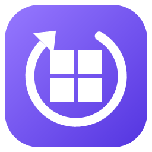
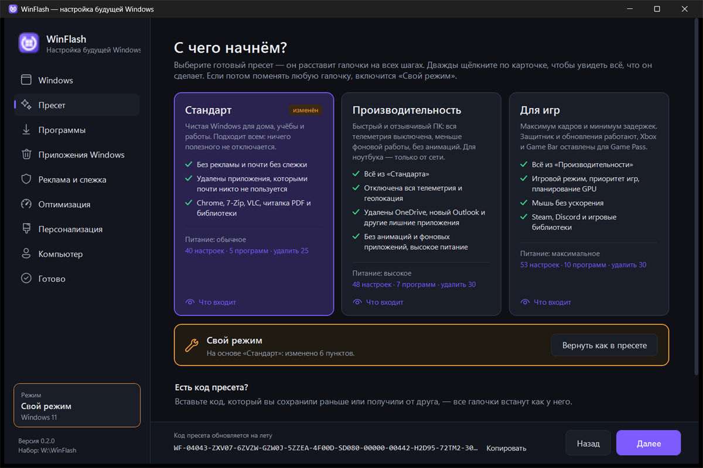
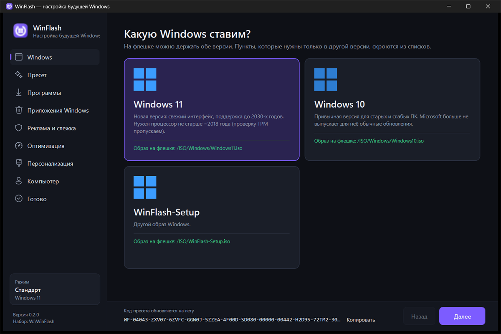
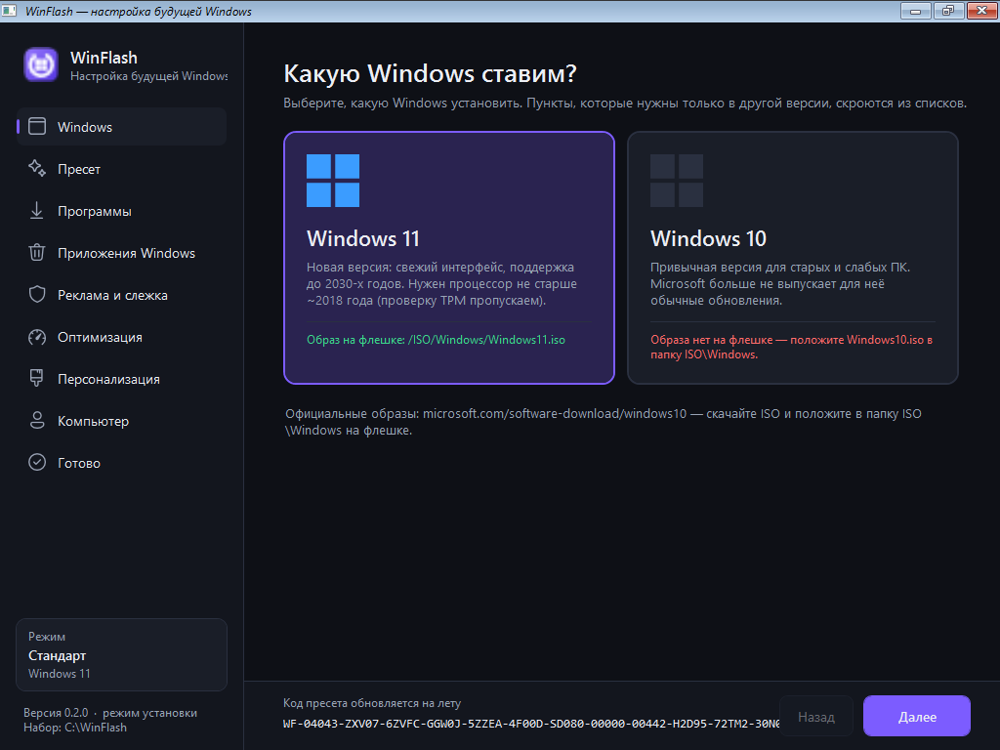
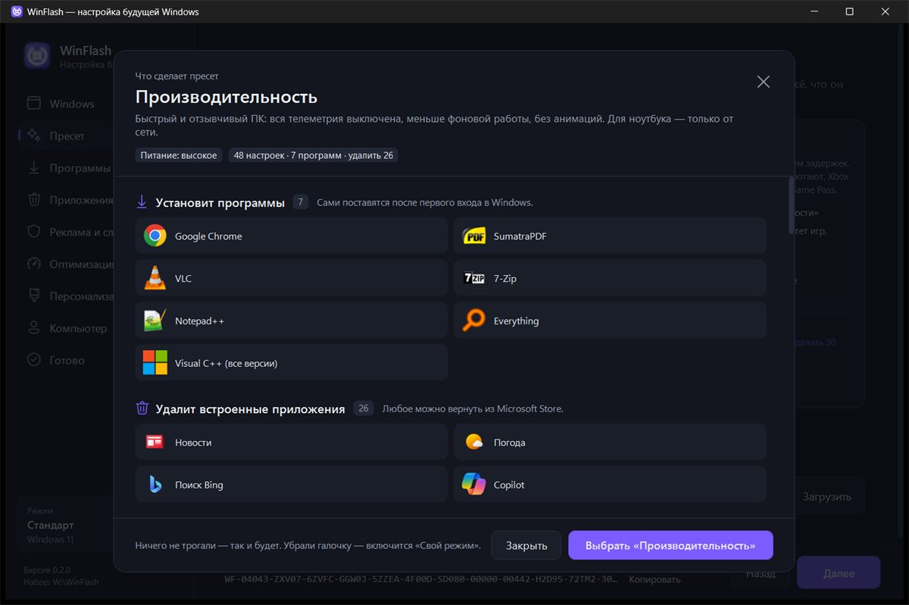
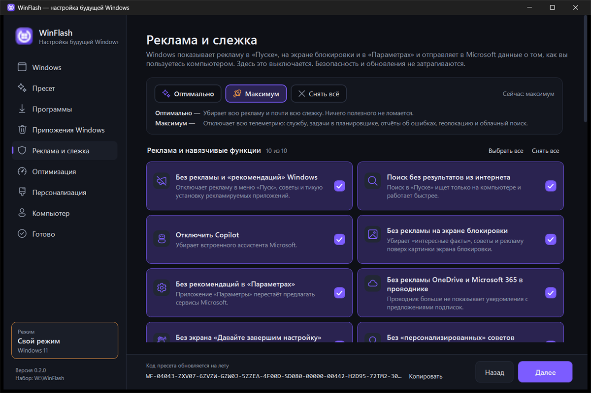
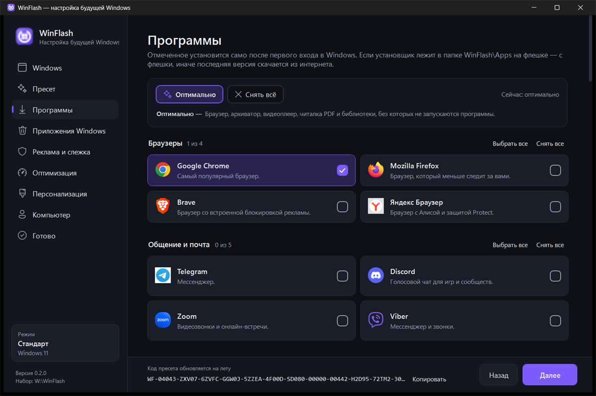
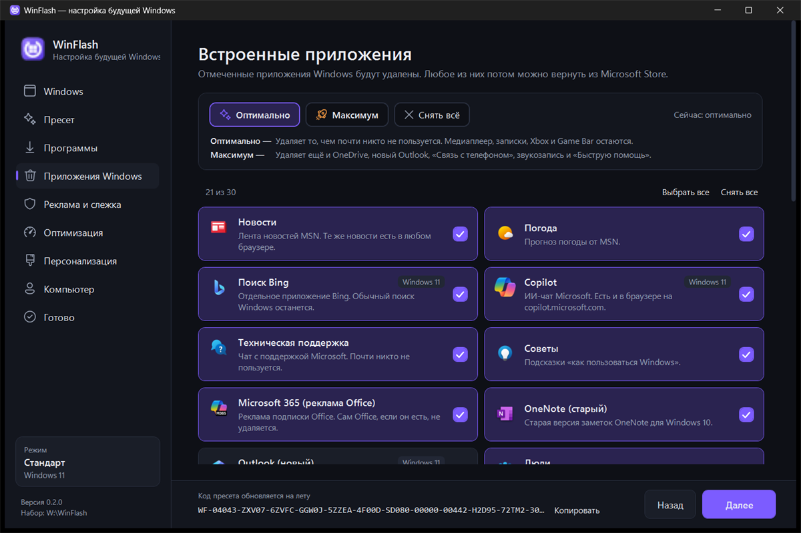

<p align="center">
  
</p>

<h1 align="center">WinFlash</h1>

<p align="center">
  Флешка для переустановки Windows 10 и 11, после которой ничего не нужно настраивать:<br>
  программы ставятся сами, реклама и слежка выключены, лишние приложения удалены.
</p>

<p align="center">
  <a href="https://github.com/nortex-labs/WinFlash/releases/latest"></a>
  <a href="LICENSE"></a>
  
</p>

<p align="center"><b>Русский</b> · <a href="README.en.md">English</a></p>



## Скачать

Откройте [последний выпуск](https://github.com/nortex-labs/WinFlash/releases/latest) и скачайте:

| Файл | Что это |
|---|---|
| `WinFlash-<версия>.zip` | Программа настройки. Распакуйте в корень флешки. |
| `WinFlash-Setup.iso` | Загрузочный образ: позволяет настроить всё прямо при загрузке с флешки. Положите в папку `ISO` на флешке. |

Ещё понадобятся [Ventoy](https://www.ventoy.net) (делает флешку загрузочной) и образ Windows с сайта Microsoft:
[Windows 11](https://www.microsoft.com/software-download/windows11) или [Windows 10](https://www.microsoft.com/software-download/windows10).

> [!NOTE]
> Программа не подписана цифровой подписью, поэтому Windows может показать окно SmartScreen
> «Система Windows защитила ваш компьютер». Нажмите **«Подробнее» → «Выполнить в любом случае»**.

## Возможности

- **Ничего не настраивать после установки.** Выбранные программы ставятся сами при первом входе, настройки применяются автоматически.
- **Готовые пресеты.** «Стандарт», «Производительность», «Для игр». Двойной щелчок по карточке показывает всё, что сделает пресет.
- **Не нужно читать каждую галочку.** На каждой вкладке есть кнопки «Оптимально» (подходит всем) и «Максимум» (выключить всё, что можно).
- **Без рекламы и слежки.** Реклама в «Пуске» и на экране блокировки, Copilot, телеметрия, отчёты, задачи сбора данных — всё выключается.
- **Чистая Windows.** Удаляет встроенные приложения, которыми почти никто не пользуется. У каждого — значок и пояснение, что это такое.
- **50+ программ одной галочкой.** Браузеры, мессенджеры, офис, плееры, утилиты, лаунчеры игр, библиотеки Visual C++ и .NET.
- **Windows 10 и 11 на одной флешке.** Пункты, которые не нужны выбранной версии, скрываются сами.
- **Можно откатить.** Все изменения реестра записываются в журнал и возвращаются одной командой.

## Быстрый старт

1. Установите [Ventoy](https://www.ventoy.net) на флешку (от 16 ГБ).
2. Распакуйте `WinFlash-<версия>.zip` в корень флешки. Образы Windows положите в `ISO\Windows`, а `WinFlash-Setup.iso` — в `ISO`.
3. Загрузитесь с флешки (Boot Menu: обычно F8, F11, F12 или Esc) и выберите **«WinFlash — настроить и установить Windows»**.
4. Выберите Windows 11 или 10, пресет и нажмите **«Начать установку Windows»**. В установщике Windows выберите язык, редакцию и диск — дальше всё пойдёт само.

**Можно настроить заранее**, на любом компьютере: запустите `WinFlash.exe` в корне флешки, отметьте нужное и нажмите
**«Записать на флешку»**. Потом при загрузке выберите «Windows 11 — установка» и пункт `winflash.xml`.



Так выглядит то же окно при загрузке с флешки — в режиме установки:



## Пресеты

| | Стандарт | Производительность | Для игр |
|---|---|---|---|
| Реклама, навязчивые функции, Copilot | выкл. | выкл. | выкл. |
| Телеметрия | почти вся выкл. | вся выкл. (служба, задачи, отчёты, геолокация) | вся выкл. |
| Удаление встроенных приложений | редко используемые | + OneDrive, новый Outlook, «Связь с телефоном» | как в «Производительности» |
| Фоновые приложения Store, анимации | как есть | выкл. | выкл. |
| Приоритет игр, планирование GPU, мышь без ускорения | — | — | вкл. |
| Программы | Chrome, 7-Zip, VLC, SumatraPDF, Visual C++ | + Notepad++, Everything | + Steam, Discord, DirectX, .NET |
| Электропитание | сбалансированное | высокое | максимальное |

Поменяли любую галочку — включается **«Свой режим»**; кнопка «Вернуть как в пресете» отменяет правки.

<table>
  <tr>
    <td></td>
    <td></td>
  </tr>
  <tr>
    <td></td>
    <td></td>
  </tr>
</table>

## Коды пресетов

Внизу окна всегда виден код вида `WF-0403F-ZRB03-…`. Его можно сохранить или отправить другу:
на шаге «Пресет» вставьте код в поле «Есть код пресета?» — все галочки встанут так же.
Пароль в код не попадает.

## Программы без интернета

Положите установщик в папку `WinFlash\Apps` на флешке — он будет использован вместо скачивания.
Имя файла должно подходить под маску из `WinFlash\catalog\apps.json` (поле `offline`), например `SteamSetup.exe`.
Если установщика нет, программа скачается через winget.

## Что важно знать

> [!IMPORTANT]
> - Установка Windows стирает выбранный диск. Диск вы выбираете сами в окне установщика — сохраните нужные файлы заранее.
> - Если вы задали пароль, он хранится на флешке **открытым текстом** в `ventoy\script\winflash.xml`. Не давайте флешку посторонним или оставьте пароль пустым. С установленной Windows этот файл удаляется после первого входа.
> - Проверки TPM 2.0, Secure Boot и объёма памяти для Windows 11 пропускаются, чтобы она ставилась и на старые ПК.
> - Пресеты «Производительность» и «Для игр» выключают определение местоположения: перестанут работать погода по месту и «Найти устройство».

WinFlash не отключает Защитник Windows, SmartScreen, Smart App Control, обновления и восстановление системы.

**Свой шаблон автоустановки.** Если хотите задать язык, редакцию или другие параметры установки, положите свой
`autounattend.xml` под именем `WinFlash\config\base.xml` — программа возьмёт его вместо стандартного и добавит в него свои команды.

## Приватность и данные

WinFlash ничего не отправляет разработчику и не собирает статистику.

| Что | Где хранится |
|---|---|
| Ваш выбор (галочки, пресет) | `WinFlash\config\selected.json` на флешке |
| Файл автоустановки (имя ПК, пользователя, пароль) | `ventoy\script\winflash.xml` на флешке |
| Копия программы на установленной Windows | `C:\ProgramData\WinFlash` |
| Журналы и журнал отката | `C:\Windows\Setup\WinFlash\Logs\` (`apply-*.log`, `undo-*.json`) |

Куда обращается программа после установки Windows:
- **winget** — скачивает выбранные программы из официальных источников;
- проверка интернета перед скачиванием: `msftconnecttest.com`, `cdn.winget.microsoft.com`, `google.com/generate_204`.

**Как удалить:** удалите папку `C:\ProgramData\WinFlash` и, если не нужны журналы, `C:\Windows\Setup\WinFlash`.
Чтобы вернуть изменения реестра и задачи планировщика, запустите от имени администратора
`C:\ProgramData\WinFlash\scripts\Undo-Profile.ps1`. Удалённые приложения возвращаются из Microsoft Store.

## Системные требования

- Компьютер, на который ставится Windows: как для Windows 10 или 11 (проверки TPM и Secure Boot пропускаются).
- Программа настройки: Windows 10 или 11 (.NET Framework 4.8 уже встроен).
- Флешка от 16 ГБ с [Ventoy](https://www.ventoy.net). Программа занимает около 1 МБ, загрузочный образ — около 540 МБ.
- Интернет после установки — для скачивания программ (или установщики в `WinFlash\Apps`).

## Частые вопросы

**При запуске пишет «Не найдена папка набора».**
Запускайте `WinFlash.exe` из корня флешки или из папки `WinFlash` — рядом должна быть папка `catalog`.

**На первом шаге «Образа нет на флешке».**
Положите ISO с Windows в папку `ISO\Windows`. В имени файла должно быть `11` или `10`, например `Windows11.iso`.

**При выборе раскладки Windows пишет «Возникла проблема» и код `OOBEKEYBOARD`.**
Это сбой самого установщика Windows. Нажмите «Попробовать ещё раз» и выберите раскладку снова — со второго раза проходит.

**Какая-то программа не установилась.**
Причина — в журнале `C:\Windows\Setup\WinFlash\Logs\apply-*.log`. Чаще всего нет интернета или установщик
не уложился в 15 минут. Программу можно поставить вручную.

**Встроенное приложение не удалилось.**
Сразу после первого входа Windows обновляет приложения, и удаление может зависнуть — тогда оно пропускается
через 90 секунд. Удалите приложение вручную в «Параметрах» → «Приложения».

**Как применить настройки ещё раз на уже установленной Windows?**
Запустите от имени администратора: `C:\ProgramData\WinFlash\WinFlash.exe --apply --force`.

## Сборка из исходников

Нужен [.NET SDK](https://dotnet.microsoft.com/download) (программа собирается под .NET Framework 4.8):

```powershell
git clone https://github.com/nortex-labs/WinFlash
cd WinFlash
.\build.ps1                # сборка в dist\WinFlash
.\build.ps1 -Flash E:\     # сборка и копирование на флешку
```

Устройство проекта, сборка загрузочного образа и выпуск версий — в [CONTRIBUTING.md](CONTRIBUTING.md).

## Лицензия

[MIT](LICENSE). Иконки интерфейса — [Fluent UI System Icons](https://github.com/microsoft/fluentui-system-icons) (MIT).
Логотипы программ принадлежат их владельцам и используются только для обозначения программ.
Загрузочный образ собран из Windows PE (Windows ADK, © Microsoft).
